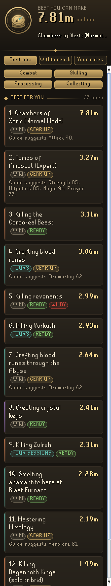
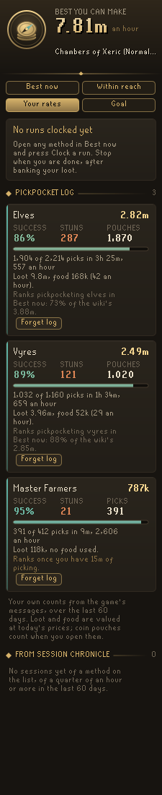
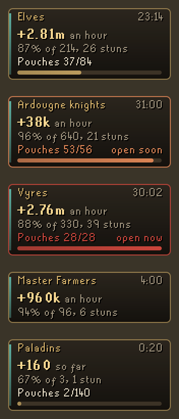
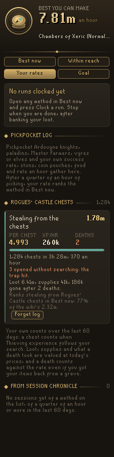
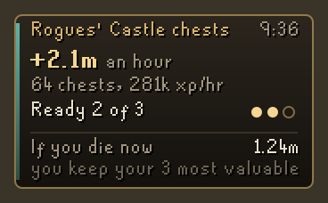
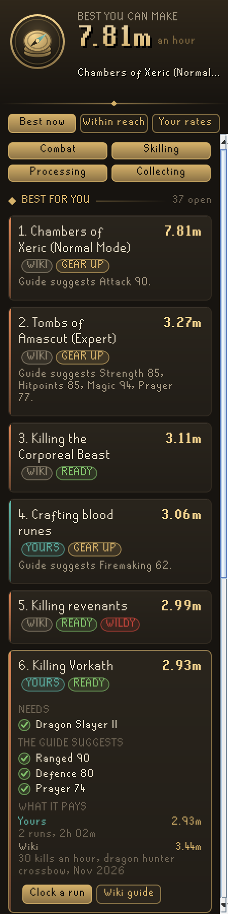
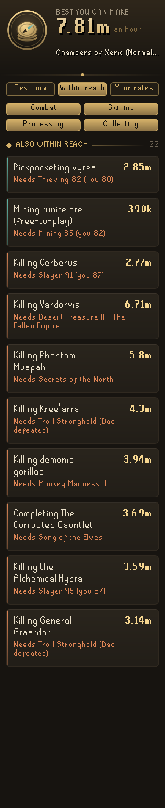
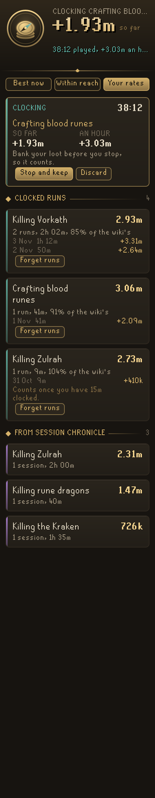
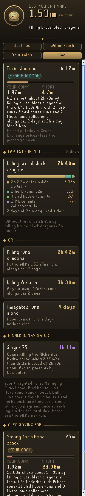
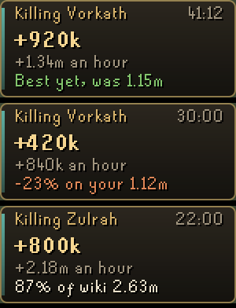

# Codex Money Pilot

Which money makers can this account do right now, and which pays **you** the most an hour?

Money Pilot reads your levels, quests and achievement diaries, checks them against what each money
making method needs, and ranks the ones you can do by profit an hour. It starts from the Old School
wiki's money making guide, and as you clock your own runs your figure takes over from the wiki's, so
the list follows how you actually play.

## What it does

- **Best now**: every method you can do today, best paying first. Each card says where its figure
  comes from (Wiki, Yours, or Your sessions) and how you fit it: *Ready*, *Gear up* (the guide
  suggests more than you have), or *Check* (a need the game does not show, such as having beaten Dad
  in Troll Stronghold). Open a card for its needs, the guide's suggestions with a tick or cross for
  each, what it pays by every source, and a link to the wiki guide.
- **Within reach**: what is nearest to opening up and exactly what it still needs ("Runecraft 77
  (you 74), Sins of the Father"), with the ones that would pay more than your best today first.
  Methods you could start but are far below the guide's suggested levels (a level 3 account and the
  Chambers of Xeric, say) are listed here as a *Stretch* rather than ranked with the rest.
- **Your rates**: the runs you have clocked, method by method, against the wiki's figure.
- **Clock a run**: press it on any method. Money Pilot notes what your bank, inventory and worn gear
  hold, and when you stop it values the difference at today's Grand Exchange prices, so a price
  moving while you play is not counted as money made. Time only runs while you are logged in. A
  small plaque on the game screen shows the time, profit so far and rate.
- Your own figure replaces the wiki's once a method has a quarter of an hour clocked in the last 60
  days.
- Free-to-play accounts only see free-to-play methods, and ironmen do not see methods that buy their
  supplies. Wilderness methods are marked and can be hidden.

- **Goal**: how fast can you afford it? Money Pilot reads the savings goal you picked in **Codex Gear
  Roadmap** (priced at today's Grand Exchange prices, less the pieces you own) or a coins goal you type
  in its settings, takes off the coins in your bank and pack, and plans the rest: the best paying
  method you can do, at your own clocked rate where you have one, with your timegated runs fitted in
  alongside, and a finish date at the hours a day you play ("4.2m short: about 2h 40m of brutal black
  dragons at the wiki's 1.53m/hr, with 2 herb runs, 3 bird house runs and 2 Miscellania collections
  alongside. 2 days at 2h a day"). Below it: the next best methods, your timegated runs alone, and any
  goal pinned in **Codex Navigator** that would open a better paying method ("Slayer 95 opens the
  Alchemical Hydra: then 1h 11m instead of 2h 40m").
- **Run coach**: while a run is clocked, the plaque and the panel weigh its rate against your best
  run of that method, your usual rate and the wiki's ("Best yet, was 1.15m", "-23% on your 1.12m",
  "87% of wiki 2.63m"). Loot reaches your bank in lumps, so the coach weighs the rate as it stood when
  the last lump landed and keeps its verdict until the rate is clearly past the line, so it does not
  flicker between kills.

- **Pickpocket log**: pickpocket Ardougne knights, paladins, Master Farmers, vyres or elves and Money
  Pilot keeps your own log of each, for each account: picks tried, picks that worked, stuns (from the
  game's own messages), coin pouches opened, the loot and the food and drink you used, valued at
  today's Grand Exchange prices. Your rates tab shows your own success rate and profit an hour at each
  target, and once you have a quarter of an hour of picking at one, your rate ranks that method in
  Best now (below runs you clocked, above Session Chronicle's sessions). Nothing works out a success
  chance from a formula: it counts what happened to you.
- **Pickpocket plaque**: while you pick, a small plaque on the game screen shows the rate an hour of
  this sitting, your success rate and stuns, and the coin pouches you hold against how many you can
  hold (28, or 56, 84 and 140 after the medium, hard and elite Ardougne Diary). It turns ember a few
  pouches before the cap and says so once in chat, so you open them before a pick is wasted.

 

- **Rogues' Castle chest log**: search the chests at the Rogues' Castle and Money Pilot logs your own
  looting, for each account: chests opened (a chest counts when Thieving experience follows your
  "Search for traps"), the Thieving experience itself, the loot (also when it goes into an open
  looting bag), the food and potion doses you used, chests opened without searching that the trap hit,
  and deaths while looting, with what was gone after each death counted against the rate. Your rates
  shows loot per chest, experience and profit an hour, and after a quarter of an hour of looting your
  rate ranks the method in Best now, as the pickpocket log does.
- **Chest plaque**: at the chests, a plaque shows the sitting's rate and experience an hour, how many of
  the chests in view stand ready and when the next one restocks (34 ticks after it was seen open), and
  **if you die now**: what you carry less the three most valuable items (none when skulled, one more
  with Protect Item), plus anything in a looting bag, at today's prices. It is a figure to read, not an
  alarm; Codex Guardian keeps watch for player killers.

 

  

 

### How the goal is planned

Each day you play for the hours set in the settings (2 by default). Miscellania is collected once a
day. Bird houses and herb runs are done each time they come round while you play, and once at each
login after the first day, for what grew while you were away. The minutes a run takes come out of the
main method, and a run is only fitted in when it pays more for its minutes than the main method
would; a method you can do at 3m an hour pays more than a bird house run's minutes, and the plan says
so by leaving it out. The runs, from the wiki's guides (read 4 November 2026):

| Run | Needs | Per run (after tax) | Takes | Every |
| --- | --- | --- | --- | --- |
| Bird houses (4 redwood) | Hunter 89, Bone Voyage | 52,254 | 1.4 minutes | 50 minutes |
| Herb runs (ranarr / snapdragon / torstol, the best paying one) | Farming 32 / 62 / 85, Ghosts Ahoy, My Arm's Big Adventure, Fairytale I - Growing Pains | 178,960 / 175,174 / 146,724 | 6 minutes | 90 minutes |
| Managing Miscellania | Throne of Miscellania | 21,976 | 30 seconds | a day |

Only methods with a wiki guide are planned; nothing is guessed for methods the guide does not cover.

## Works with the Codex suite

If **Codex Session Chronicle** is installed, the sessions it files count too: a session spent mainly
on Vorkath gives Money Pilot your Vorkath rate. It uses the net worth Codex Ledger saw the session
gain when Ledger is running, or Chronicle's loot less supplies otherwise. Money Pilot only reads
Chronicle's journal and never changes it.

It also reads, and never changes, **Codex Gear Roadmap**'s savings goal (`codexgearroadmap.goal`) and
**Codex Navigator**'s goal board (`codexnavigator.goalBoard`). Either can be missing; the Goal tab then
plans for the coins goal in the settings, or says how to set one.

## Good to know

- Open your bank once so Money Pilot knows what you start a run with.
- Bank your loot before you stop a run. Items in a looting bag, rune pouch or Grand Exchange offer
  are not counted until they reach your bank, pack or gear.
- The pickpocket log knows which NPC you picked from the coin pouch it gives (each kind gives its own),
  so picks of an elf or vyre before its first pouch wait until then, and picks of NPCs it does not log
  (men, H.A.M. members) are left out. Pouches count when you open them. Seeds that go straight into
  a seed box count only if the game shows the box changing.
- The chest log's "if you die now" uses RuneLite's item prices to choose the kept items, where the game
  uses its own values, and treats a stack as single items (three runes of a stack are three kept
  items), so it says what a death would roughly cost. It is not worked out for ultimate ironmen, whose
  rules differ.
- Money Pilot reads the game and never acts in it. It shows numbers and wiki links, never what to
  click. Nothing leaves your computer.

## Where the numbers come from

Every method is a page of the Old School wiki's money making guide
(`oldschool.runescape.wiki/w/Money_making_guide/...`), read on 3 November 2026. A level counts as a
**need** only where the game checks it (an altar, a door, a slayer level, a spell) or the guide marks
it required; everything else the guide lists is a **suggestion**. The wiki's profit figures move with
prices, which is why your own clocked rate replaces them.

| Method | Needs (from the wiki) |
| --- | --- |
| Crafting blood runes | Runecraft 77, Sins of the Father |
| Crafting death runes through the Abyss | Runecraft 65, Enter the Abyss, Mourning's End Part II |
| Crafting wrath runes | Runecraft 95, Dragon Slayer II |
| Smelting runite / adamantite bars at Blast Furnace | Smithing 85 / 70, started The Giant Dwarf |
| Pickpocketing vyres / elves | Thieving 82 + Sins of the Father / Thieving 85 + Song of the Elves |
| Pickpocketing Ardougne knights / paladins / master farmers | Thieving 55 / 70 / 38 (read 4 November 2026) |
| Rogues' Castle chests | Thieving 84, Prayer 43, Medium Wilderness Diary |
| Casting Tan Leather | Magic 78, Lunar Diplomacy, Hard Fremennik Diary |
| Killing Kree'arra | Ranged 70 (Armadyl's Eyrie, unboostable), Troll Stronghold |
| Killing Commander Zilyana / General Graardor / K'ril | Agility 70 / Strength 70 and Prayer 43 / Hitpoints 70, Troll Stronghold |
| Slayer bosses and monsters | Hydra 95, Cerberus 91, Kraken 87, brutal black dragons 77, gargoyles 75 Slayer |
| Vorkath, rune dragons | Dragon Slayer II |
| Zulrah | Started Regicide |

The full list, with each page's wording, is in `MethodsTest.gatesMatchTheWiki` and `core/Methods.java`.

## Settings

- **Show Wilderness methods** (on)
- **Run plaque** (on): the clocked run on the game screen
- **Chat line when a run ends** (on)
- **Run coach** (on): the coach's line on the plaque and the panel while a run is clocked
- **Pickpocketing**: *Log pickpocketing* (on), *Pickpocket plaque* (on) and *Pouch warning* (3
  pouches before the cap; 0 for none)
- **Rogues' Castle chests**: *Log the chests* (on), *Chest plaque* (on) and *If you die now* (on)
- **Goal**: *Coins goal (thousands)* (0, none), *Coins goal name*, *Hours played a day* (2), and
  *Plan Gear Roadmap's goal* (on)
- **Keep field notes** (off): a local record of what the plugin reads and decides, for checking its
  guesses, written to `.runelite/plugin-data/codex-money-pilot`

## Part of Codex

Codex is a suite of RuneLite plugins that share one look and read each other's data, each useful on
its own: Navigator, Guardian, Ledger, Session Chronicle, Gear Roadmap and more.
